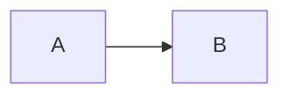

<p align="center">
  
</p>

# The example guide

Everything about the example, in the order you need it. The [API reference](../api/API.md) has the details.

## Contents

1. [Install](#install)
2. [Usage](#usage)

## Install

Run the following:

```sh
# a comment, not a heading
docker compose up -d
```

### Details

See the [options](#options), the [readme](../README.md), the [examples](../examples) folder and
[another site](https://example.org/page "A title").

> [!WARNING]
> Back up the data first.

## Usage

[](https://ci.example.org)

Use it every day.

### Options

Text with <placeholder> outside code, `<kept>` inside code, a link [back to the install](#install) and one
[to `the API`](../api/API.md#part-one) with code in its text.

### Details

A second heading with the same text.

```
no language here
```


