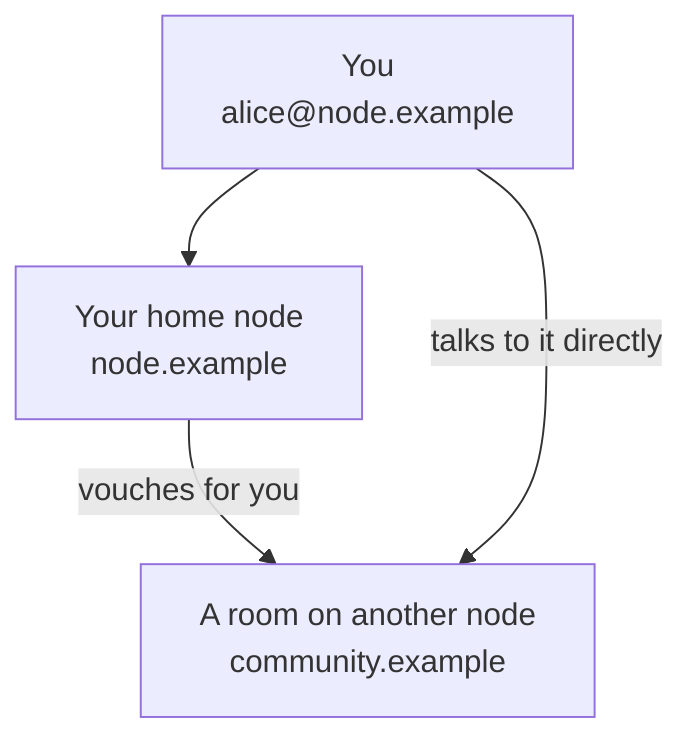

import Screenshot from "../../../components/docs/Screenshot.astro";

tavrn is a chat for communities and friends: rooms with text and voice channels, direct messages, calls and
shared files. Conversations are end-to-end encrypted by default, so only the people in them can read them.

## Nodes and your address

tavrn has no central server. It runs on many **nodes**, servers that people, clubs or companies run for their
communities. Your account lives on one of them, your **home node**.

Your address looks like an e-mail address, for example `alice@node.example`: your username before the `@`, the
domain of your home node after it. Friends find you by this address. The username cannot be changed later; your
display name can.

One account is enough for the whole network. With your address you can join rooms on every other node and write
to people on other nodes, without registering again.

## Picking a node

Often your community already uses a node, and you register there. If you choose yourself, look at three things:

- **Who runs it.** Your account and the rooms on the node depend on it staying online, so pick an operator you
  trust to keep it running.
- **Who may register.** A node is open, accepts new accounts by invitation only, or is closed.
- **Its legal pages.** The imprint, the privacy policy and the terms of a node are linked from the sign-in page
  and from the account menu.

The **Discover** page in the app lists public nodes with their registration mode, and you can also
[run a node of your own](/docs/admins/overview/).

:::note
The operator of a node cannot read your encrypted conversations, but sees some information about them, such as
who is in which room. [Privacy and encryption](/docs/users/privacy-and-encryption/) explains what that means.
:::

## Using tavrn in the browser

Every node serves the web app: open your node's address in a current browser and choose **Register**. You pick a username (2 to 32 characters: letters, digits, `_`, `.` and `-`)
and a password of at least 10 characters. Some nodes also ask for an invite code or your date of birth.

<Screenshot scene="register-desktop" />

A short wizard then sets up a second factor, shows your recovery codes and gives you your recovery key.
[Your account](/docs/users/account/) explains each of them; keep the recovery key somewhere safe.

<Screenshot scene="login-desktop" />

If your account is on another node, choose **Sign in with an account of another node** and enter your full
address, or better, use the web app of your own node.

<Screenshot scene="login-remote-desktop" />

## The desktop app

The desktop app for Windows and Linux is on the [download page](/download). At the first start it asks for your
address (or just the domain of your node), finds your home node and opens the sign-in page. Passkeys, single
sign-on and captchas run on your node's own page in a small sign-in window.

The app adds push-to-talk keys that also work while a game has the focus, a tray icon and system notifications.
Builds for macOS are experimental, and an iOS app is planned.

## The Android app

The Android app (Android 8 and newer) is on the [download page](/download) as well. It signs in the same way and
adds push notifications without Google services (through UnifiedPush), voice that keeps running in the background,
and unlocking your messages with your fingerprint, your face or the phone's PIN.
